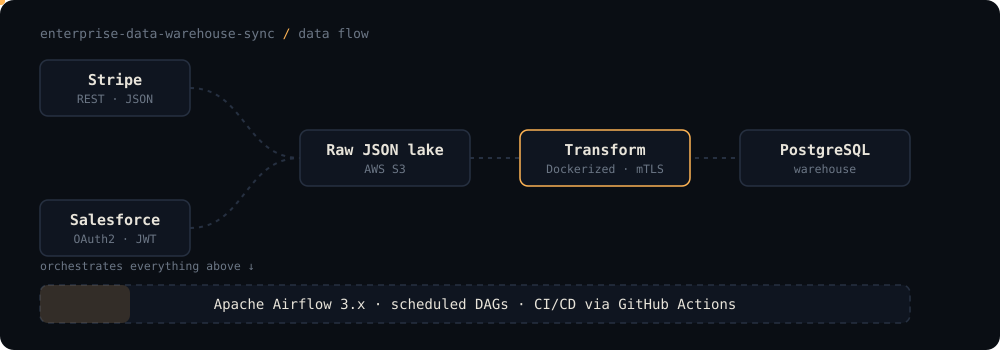
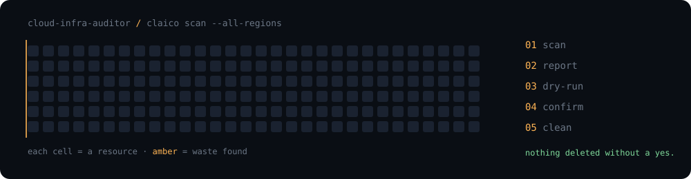

<div align="center">

```text
╔══════════════════════════════════════════════════════════════════════════════════════╗
║                                                                                      ║
║                      █   █  ███  ████   ████ █   █ █████ █                           ║
║                      █   █ █   █ █   █ █     █   █   █   █                           ║
║                      █████ █████ ████   ███  █████   █   █                           ║
║                      █   █ █   █ █  █      █ █   █   █   █                           ║
║                      █   █ █   █ █   █ ████  █   █ █████ █████                       ║
║                                                                                      ║
║                █   █  ███  █      ████  ███  ████  █████ █   █  ███                  ║
║                █  █  █   █ █     █     █   █ █   █   █    █ █  █   █                 ║
║                ███   █████ █      ███  █████ ████    █     █   █████                 ║
║                █  █  █   █ █         █ █   █ █  █    █     █   █   █                 ║
║                █   █ █   █ █████ ████  █   █ █   █ █████   █   █   █                 ║
║                                                                                      ║
║                        backend · data pipelines · cloud cost                         ║
║                                                                                      ║
║                    Computer Engineering @ CHARUSAT · Surat, India                    ║
║                                                                                      ║
║                  $ open to SDE / backend / data internships (2027)                   ║
║                                                                                      ║
╚══════════════════════════════════════════════════════════════════════════════════════╝
```


<br>

[`~/experience`](#experience) · [`~/projects`](#projects) · [`~/stack`](#stack) · [`~/oss`](#open-source) · [`~/contact`](#contact)

</div>

<br>

```console
harshil@charusat:~$ neofetch

  harshil@kalsariya
  ─────────────────────────────────────────────
  role      backend · data pipelines · cloud cost
  school    B.Tech Computer Engineering @ CHARUSAT (2028)
  cgpa      8.26 / 10
  based     Surat, Gujarat, India
  focus     distributed systems · ETL · AWS cost optimization
  editor    vim, when no one is watching
  status    ● open to SDE / backend / data internships (2027)
```

<br>

## experience

```console
harshil@charusat:~$ git log --oneline --graph

* 7c1e9a4 (HEAD -> main) now: Airflow 3, distributed systems, more C++
* 3b8d2f0 2026  GSSoC: rank #2,174 / 47,924 (top 5%), 4 merged PRs, 3 repos
* a91c5e7 2026  published cloud-infra-auditor to PyPI
* e402b6d 2026  shipped CertifyPro (live, full-stack)
* 5d7f3c1 Apr-Jun 2026  Zaalima Development: Python Developer Intern & Team Lead
|          led a team of 4 · concurrent AWS auditing across 17+ regions
|          Stripe + Salesforce -> PostgreSQL ETL, 3-stage validation, idempotent loads
* 0000001 init: Computer Engineering @ CHARUSAT
```

<br>

## projects

```console
harshil@charusat:~$ ls -l projects/
```

<details>
<summary><code>drwxr-xr-x</code> <b>enterprise-data-warehouse-sync/</b> · Stripe + Salesforce -> PostgreSQL</summary>

<br>

<div align="center"></div>

```text
stripe ──┐
         ├─> raw JSON ─> S3 ─> validate ─> transform ─> validate ─> PostgreSQL
salesforce ┘                                                │
                    Airflow 3 (daily DAGs, retries) ────────┘
                    Slack alert on failure
```

```yaml
stack:   [Python, Airflow 3.x, Docker, PostgreSQL, AWS S3, GitHub Actions]
auth:    Salesforce JWT + mTLS between services
gates:   [source models, after conversion, before load]
result:  0 duplicates across 3 repeated runs (5,000 SF + 500 Stripe records)
tests:   7 pytest
```

Debugged a five-service Airflow 3 deployment (API server, scheduler, triggerer, DAG processor, webserver) and asyncpg dependency conflicts.

[**-> repo**](https://github.com/harshil6-lab/enterprise-data-warehouse-sync)

</details>

<details>
<summary><code>drwxr-xr-x</code> <b>cloud-infra-auditor/</b> · AWS waste scanner CLI (CLAICO)</summary>

<br>

<div align="center"></div>

```bash
pip install cloud-infra-auditor
```

```console
$ claico scan --all-regions
  scanning 17+ regions ............ done
  idle EC2 instances (CloudWatch) .. found
  unattached EBS volumes ........... found
  unassociated Elastic IPs ......... found
  cleanup runs only after: dry-run -> explicit confirmation
```

```diff
- before   sequential scan       60-65s
+ after    ThreadPoolExecutor     8-10s     (~85% faster)
+ tests    90%+ coverage
```

```yaml
stack:  [Python 3.11, Typer, Rich, Boto3, Pytest, Moto, Docker]
output: [JSON, CSV, Rich terminal dashboard]
team:   [Rifaz G, Sravya M, Prakash Bhanu]
```

[**-> repo**](https://github.com/harshil6-lab/cloud-infra-auditor)

</details>

<details>
<summary><code>drwxr-xr-x</code> <b>certifypro/</b> · bulk certificate issuing + verification</summary>

<br>

```text
Excel/CSV ─> FastAPI ─> Supabase ─> hundreds of certificates
                                      └─> QR code / GET /verify/{id}
```

```yaml
stack: [React, TypeScript, FastAPI, Supabase, Tailwind]
```

[**-> repo**](https://github.com/harshil6-lab/certifypro)

</details>

<details>
<summary><code>drwxr-xr-x</code> <b>automations/</b> · n8n, LLMs, OCR</summary>

<br>

```text
ai-resume-screening   LLM extracts skills -> rules rank -> n8n emails result
                      [n8n, OpenAI, Gemini, SMTP]

gmail-routing         Gemini classifies email -> support | billing | spam
                      [n8n, Gemini, Google APIs]

invoice-ocr           tabular, free-form, scanned invoices -> Google Sheets rows
                      [Python, OCR, Sheets API]
```

</details>

<br>

## stack

```console
harshil@charusat:~$ tree stack/
```

```text
stack/
├── languages/     C · C++ · Python · Java · SQL · Bash · TypeScript
├── backend/       FastAPI · REST · SQLAlchemy · React
├── data/          Airflow · PostgreSQL · MySQL · Supabase · S3 · ETL
├── infra/         AWS (EC2, S3, EBS, VPC, IAM, CloudWatch) · Docker · Linux · GitHub Actions
├── quality/       Pytest · Moto · unit testing · code review · concurrency
├── networking/    TCP/IP · UDP · Ethernet · IEEE 802.11 (coursework)
└── automation/    n8n · OpenAI · Gemini · Google APIs
```

<div align="center">

</div>

<br>

## open source

```console
harshil@charusat:~$ cat gssoc2026.log
```

```text
[GSSoC 2026]  rank #2,174 / 47,924   top 5%
[merged PRs]  4 across 3 repositories
[leetcode]    150+ solved · 50-day + 100-day streaks
```

<br>

## contact

```console
harshil@charusat:~$ cat contact.json
```

```json
{
  "email":    "harshilkalsariya28@gmail.com",
  "linkedin": "harshil-kalsariya-629651318",
  "github":   "harshil6-lab",
  "leetcode": "harshil6-lab",
  "status":   "open to internships, say hi"
}
```

<div align="center">

[**resume**](https://drive.google.com/uc?export=download&id=13cSdKFxJvpLsCDuLH6LyFy4JJv_vztJ7) &nbsp;·&nbsp; [**email**](mailto:harshilkalsariya28@gmail.com) &nbsp;·&nbsp; [**linkedin**](https://linkedin.com/in/harshil-kalsariya-629651318) &nbsp;·&nbsp; [**leetcode**](https://leetcode.com/u/harshil6-lab)

</div>

```console
harshil@charusat:~$ _
```


